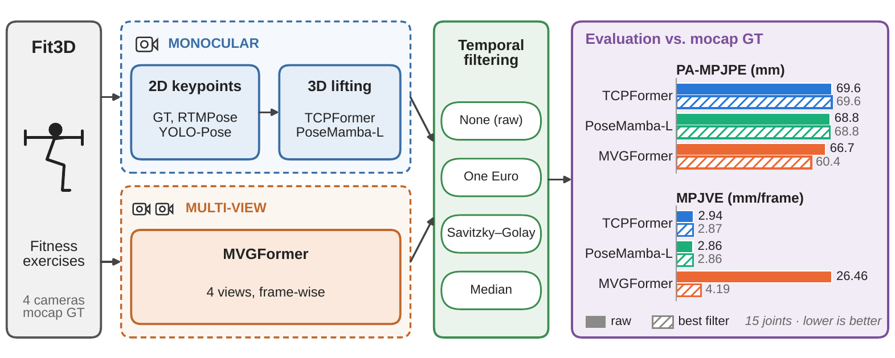
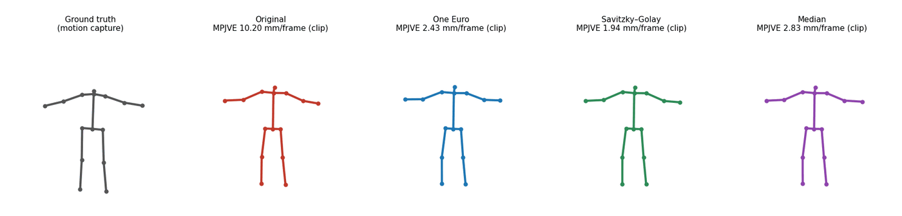

# Monocular vs. Multi-view 3D Human Pose Estimation for Fitness Exercise Analysis

[](LICENSE)


Official code of the paper **"Comprehensive Evaluation of Monocular and Multi-view 3D Human Pose Estimation Models for Fitness Exercise Analysis"** (Néstor Ortega, Agustín Salgado, Javier Sánchez; CTIM–IUCES, University of Las Palmas de Gran Canaria). Preprint available on [arXiv:2611.02929](https://arxiv.org/abs/2611.02929).

<p align="center">
  
</p>

## Overview

This repository contains the code needed to reproduce every number and figure of the paper. It evaluates, under a single protocol, three recent 3D human pose estimation models on **Fit3D**, a dataset of synchronized multi-view fitness recordings with motion-capture ground truth:

| Model | Type | Input |
|---|---|---|
| [TCPFormer](https://doi.org/10.1609/aaai.v39i5.32583) | Transformer lifting (implicit pose proxy) | 2D keypoint sequence (T = 243) |
| [PoseMamba-L](https://doi.org/10.1609/aaai.v39i4.32401) | State-space (Mamba) lifting | 2D keypoint sequence (T = 243) |
| [MVGFormer](https://doi.org/10.1109/cvpr52733.2024.00074) | Multi-view, frame-wise | 4 synchronized RGB views |

The study addresses three questions:

1. **Influence of the 2D detector.** TCPFormer and PoseMamba-L are fed with ground-truth 2D keypoints, RTMPose detections and YOLO-Pose detections.
2. **Monocular vs. multi-view.** The three models are compared on a common 15-joint skeleton (COMMON15).
3. **Temporal post-processing.** One Euro, Savitzky–Golay and Median filters are applied to the 3D predictions, with parameters selected globally to minimize MPJVE under a PA-MPJPE constraint.

All models are used with the checkpoints released by their authors, **without retraining or fine-tuning on Fit3D**.

## Main results

Mean PA-MPJPE (mm) over the 8 training subjects and 28 non-warm-up exercises (224 sequences per model). Lower is better.

| Model / 2D input | 17-joint skeleton | COMMON15 |
|---|---:|---:|
| TCPFormer – GT 2D | 46.16 | – |
| TCPFormer – YOLO-Pose | 93.61 | – |
| TCPFormer – RTMPose | 70.89 | 69.57 |
| PoseMamba-L – GT 2D | 37.12 | – |
| PoseMamba-L – YOLO-Pose | 84.32 | – |
| PoseMamba-L – RTMPose | 71.14 | 68.77 |
| MVGFormer (multi-view) | – | 66.69 |

Effect of temporal filtering on COMMON15 (RTMPose as 2D input for the monocular models):

| Model | Version | PA-MPJPE (mm) | MPJVE (mm/frame) |
|---|---|---:|---:|
| TCPFormer | Original | 69.566 | 2.943 |
| | One Euro | 69.713 | 2.913 |
| | Savitzky–Golay | 69.555 | **2.874** |
| | Median | 69.563 | 2.905 |
| PoseMamba-L | Original | 68.768 | 2.859 |
| | One Euro | 68.769 | 2.859 |
| | Savitzky–Golay | 68.768 | **2.856** |
| | Median | 68.768 | 2.858 |
| MVGFormer | Original | 66.691 | 26.458 |
| | One Euro | 67.091 | 6.550 |
| | Savitzky–Golay | 62.102 | 4.905 |
| | Median | **60.385** | **4.192** |

Key findings: the quality of the 2D detector is the dominant factor for monocular lifting; MVGFormer has the lowest average spatial error but degrades on floor exercises and is far less temporally consistent; filtering reduces the MVGFormer velocity error by 84 % (and also its PA-MPJPE with the Median filter) while the gains for the monocular models are small.

<p align="center">
  
  <br><em>MVGFormer on <code>band_pull_apart</code> (subject s03, seconds 5–10): ground truth, original prediction and the three filtered versions. The MPJVE shown is computed on this clip only.</em>
</p>

## Repository structure

```text
fit3d-3d-pose-benchmark/
├── notebooks/
│   ├── 00_prepare_2d_inputs.ipynb       # GT 2D projection, YOLO-Pose extraction, RTMPose format check
│   ├── 01_tcpformer_inference.ipynb     # TCPFormer inference (overlap + Hann) and evaluation
│   ├── 02_posemamba_inference.ipynb     # PoseMamba-L inference (overlap + Hann) and evaluation
│   ├── 03_mvgformer_inference.ipynb     # MVGFormer multi-view inference and evaluation
│   ├── 04_temporal_smoothing.ipynb      # Filter parameter search, filtered predictions, verification
│   └── 05_evaluation_and_figures.ipynb  # Paper tables and figures
├── assets/                              # Images used in this README
├── results/                             # Per-sequence metrics (CSV) and a subset of 3D predictions
├── requirements/                        # One requirements file per environment
├── LICENSE
├── CITATION.cff
└── README.md
```

Each notebook runs end-to-end in Google Colab, the environment used for the paper, and reads/writes everything under a single `STORAGE_ROOT` (by default `/content/drive/MyDrive`). Locally, set `STORAGE_ROOT` to any directory. Notebooks can be opened in Colab directly from GitHub (*File → Open notebook → GitHub*).

## Requirements

The experiments were run on Google Colab with **Python 3.12**, **PyTorch 2.10**, **CUDA 12.8** and a **Tesla T4** GPU. NumPy, SciPy, Pandas, Matplotlib and OpenCV are used for pose processing, filtering, evaluation and visualization.

Every model has its own dependencies, so the notebooks install them independently:

| Notebook | Extra requirements |
|---|---|
| `00_prepare_2d_inputs` | `ultralytics` (YOLO-Pose), `opencv-python` |
| `01_tcpformer_inference` | TCPFormer source code and Human3.6M checkpoint (243 frames) |
| `02_posemamba_inference` | PoseMamba source code, compiled `selective_scan` CUDA kernels, PoseMamba-L checkpoint |
| `03_mvgformer_inference` | MVGFormer source code, compiled deformable-attention CUDA operator, released checkpoint |
| `04_temporal_smoothing`, `05_evaluation_and_figures` | NumPy, SciPy, Pandas, Matplotlib (no GPU) |

> **Checkpoints and third-party code are not redistributed here.** Download them from the repositories of the original authors and follow their licenses. The notebooks indicate where each file must be placed.

## Data

1. **Fit3D.** Download the dataset from <https://fit3d.imar.ro> (academic license). The experiments use the eight subjects of the training split `s03, s04, s05, s07, s08, s09, s10, s11` and 28 exercises; warm-up sequences are excluded, giving **224 sequences per model**. Videos are 900 × 900 at 50 fps; the ground truth is `joints3d_25` (metres).
2. **Expected layout:**

```text
MyDrive/
├── VIDEOS/<subject>/<exercise>/                  # videos and joints3d_25.json
├── camera_params/<subject>/<camera_id>/<exercise>.json
└── Fit3D_2D/<subject>/
    ├── poses2d_gt/<exercise>.npy                 # GT projected to camera 65906101, (T, 17, 3)
    ├── poses2d/<exercise>.npy                    # YOLO-Pose, H36M-17, (T, 17, 3)
    └── pose2d_rtmpose/<exercise>.json            # RTMPose detections (MMPose JSON, COCO-17)
```

3. **2D inputs.** All monocular experiments use camera **65906101**, which provides a predominantly frontal view.
   - *Ground-truth 2D:* projection of the 3D ground truth with the camera calibration (`00_prepare_2d_inputs`).
   - *YOLO-Pose:* extracted from the videos with Ultralytics (`00_prepare_2d_inputs`).
   - *RTMPose:* MMPose-style JSON files, one per sequence: a list of frames, each with a `frame_id` and its `instances` (`keypoints`, `keypoint_scores`, `bbox_score`) in COCO-17 order. The instance with the highest `bbox_score` is used, and frames without detections repeat the last valid pose. The detections are provided as input data; `00_prepare_2d_inputs` documents this format and validates the files.

Detections in COCO-17 are converted to the 17-joint Human3.6M-like layout used by the lifting models (pelvis, neck and spine are computed as midpoints) and normalized following each model's input convention.

## Reproducing the paper

Run the notebooks in order:

1. **`00_prepare_2d_inputs`** – builds/validates the three 2D sources.
2. **`01_tcpformer_inference`** and **`02_posemamba_inference`** – lift the 2D sequences to 3D. Sequences longer than 243 frames are processed with sliding windows (**window 243, stride 60**), fused with a strictly positive **Hann** weighting, with the last window anchored at the end of the sequence and pelvis root-centering applied after fusion. Run the three 2D sources (GT, YOLO-Pose, RTMPose) for each model.
3. **`03_mvgformer_inference`** – multi-view, frame-wise reconstruction from the four cameras (960 × 540 network input with aspect-ratio-preserving affine transform).
4. **`04_temporal_smoothing`** – applies the One Euro, Savitzky–Golay and Median filters to the RTMPose-based monocular predictions and to MVGFormer. The final parameters (below) are used by default; the full parameter search can be re-run with `RUN_PARAMETER_SEARCH = True`. The notebook verifies every generated file and checks that PA-MPJPE and MPJVE reproduce the values reported above.
5. **`05_evaluation_and_figures`** – generates the tables and figures of the paper.

### Filter parameters

Selected globally per model and filter by minimizing the mean MPJVE over the 224 sequences, subject to a PA-MPJPE increase of at most 0.5 mm with respect to the original predictions.

| Filter | TCPFormer | PoseMamba-L | MVGFormer |
|---|---|---|---|
| One Euro (f<sub>s</sub>, f<sub>c,min</sub>, β, f<sub>d</sub>) | (50, 10, 0.01, 2) | (50, 100, 0.01, 1) | (50, 1, 0.001, 1) |
| Savitzky–Golay (N, p) | (21, 4) | (11, 4) | (21, 2) |
| Median (N) | 5 | 3 | 41 |

The One Euro filter acts on the arrays in their stored units (metres for TCPFormer/PoseMamba-L, millimetres for MVGFormer), which matters for β.

## Evaluation protocol

- **Skeletons.** TCPFormer and PoseMamba-L use a 17-joint skeleton; MVGFormer a 15-joint one. Joint-wise comparison uses **COMMON15**, which keeps the anatomically corresponding joints (Pelvis, Hips, Knees, Ankles, Neck, Nose, Shoulders, Elbows, Wrists) and discards Spine and Head.
- **PA-MPJPE** – mean joint error after per-frame Procrustes alignment (spatial accuracy).
- **MPJVE** – mean norm of the difference between predicted and ground-truth per-joint frame-to-frame displacements, in mm/frame, pelvis-centred, without Procrustes alignment or scale normalization. Because it compares velocity vectors, it is computed in a consistent frame: the monocular predictions are expressed in the frame of camera 65906101 and MVGFormer in the world frame.
- **Mean-velocity plots** – a single body-scale factor per sequence (ratio of mean bone lengths, ground truth over original prediction) is applied to original and filtered predictions; this normalization is not used for MPJVE.

## Provided results

`results/` contains the per-sequence metrics (CSV) behind every table and a subset of the 3D predictions used in the temporal-smoothing experiments. The complete set of predictions can be regenerated with the notebooks.

## Citation

If you use this code, please cite the paper:

```bibtex
@misc{ortega2026comprehensiveevaluationmonocularmultiview,
      title={Comprehensive Evaluation of Monocular and Multi-view 3D Human Pose Estimation Models for Fitness Exercise Analysis},
      author={Néstor Ortega and Agustín Salgado and Javier Sánchez},
      year={2026},
      eprint={2611.02929},
      archivePrefix={arXiv},
      primaryClass={cs.CV},
      url={https://arxiv.org/abs/2611.02929},
}
```

Please also cite Fit3D ([AIFit, CVPR 2021](https://doi.org/10.1109/cvpr46437.2021.00979)) and the original papers of the evaluated models and detectors.

## License

The code in this repository is released under the [Apache License 2.0](LICENSE). Fit3D is distributed under its own academic license, and the third-party models, checkpoints and detectors keep the licenses of their original authors.

## Acknowledgements

This work was supported by MICIU/AEI/10.13039/501100011033/FEDER, UE (grant PID2024-155753OB-I00).
